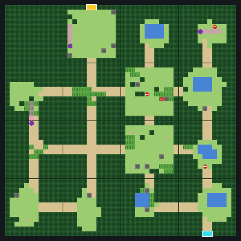
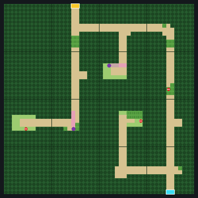
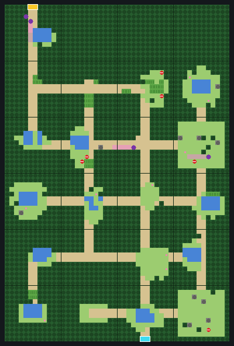
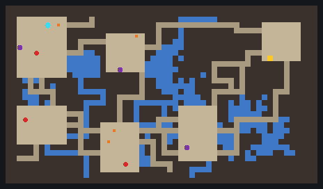
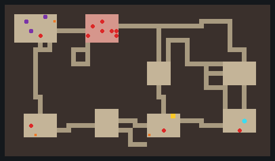
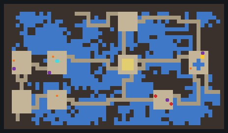

# Research: generated routes and dungeons between Kanto's spaces

- **Status:** research for your brief of 2026-10-10. Nothing is built. You made the choices in §11 the same day; the
  plan that follows from them is [WILD_ROUTES_PLAN.md](../specs/WILD_ROUTES_PLAN.md). Where the two differ (no away
  hold, route maps in the hidden game, one long route per R5), the plan wins.
- **Replaces** the vanilla-world line of work. `docs/specs/VANILLA_WORLD_PLAN.md` was dropped and removed on
  2026-10-12; it is in git at commit 9f82234.
- **Sources:**
  - your two notes, *DWM1 gate floor generation: technical notes* and *PMD Red Dungeon Floor Generation: Technical
    Report* (both 2026-10-10; not copied into the repo);
  - a read of today's code (file:line in Appendix A), and the earlier research `docs/research/VOXEL_WORLD_REPORT.md`
    (VR), mainly A4.1–A4.4 (gates and the away hold);
  - Python prototypes of both generators, run on the server (Appendix B). Nothing ran on the pod and nothing cost
    money.

## 0. Summary

- **It fits without touching Kanto's world.** Kanto stays a flat void world with its interiors underground.
  Generated routes and dungeons are built in the empty overworld, far from Kanto, and reached through gates. Kanto's
  build, layout, shape map and goldens don't change.
- **Routes: DWM's floor generator, almost as it is.** My port reproduces your reference floor (seed $1234, size 15)
  and your statistics over all 65,536 seeds. A route becomes 1–4 *areas* (DWM floors) joined by "the way on" (DWM's
  stairs), with a gatekeeper trainer at the end (DWM's boss room). Each area is a 4×4 grid of 12×12-cell blocks:
  96×96 Minecraft blocks, 36 chunks. The prototype makes one in about 17 ms, in Python.
- **Dungeons: PMD's standard floor, almost as it is.** My port, with your report's bugs fixed, made 400 valid floors
  out of 400 with no fallback, about 5 ms each in Python. A floor is 56×32 cells: 112×64 blocks, 28 chunks.
- **The hidden game needs an "away hold".** The earlier research designed one (VR A4.2) and it was never built.
  Leaving Kanto parks and freezes the hidden player at the gate. Coming back is one ordinary step across the ROM's own
  connection, so the story's own checks decide whether you may pass.
- **Five pieces are missing today** (§7): the away hold; adding items and money to the hidden bag; battles the server
  starts with a generated team; puppets and text boxes sent by the server; props drawn from their block state (the
  voxel shape map is fixed per world and 78% full).
- **Once per world or every visit:** one code path does both. A seed makes a layout, and the layout is stamped into a
  slot. Default: routes once per world, made the first time someone comes near; dungeons new on every visit, the PMD
  way.
- **Your choices** are in §11, each with a default.

## 1. Your brief, as I read it

- Keep Kanto's world generation: the flat void overworld, interiors underground, today's builder.
- *World spaces* are the maps the builder makes from your ROM. The rest of the overworld is free.
- Between world spaces: generated connecting routes, made the way DWM makes gate floors (near-identical or highly
  adapted), as mazes of terrain, placed models (trees, rocks, item balls) and custom trainers.
- In those routes: dungeons you can enter, made the way PMD makes its floors.
- Terrain from vanilla generation; objects as voxel models.
- Compare making them once per world with making them anew every time.

Two questions of reading decide a lot, so §3 sets out the options: which world spaces a route joins, and whether a
route replaces the direct way or sits beside it.

## 2. What today's code means for this

1. **Kanto's outdoor maps touch.** The ROM's connections join them edge to edge inside one box: 704×744 blocks for
   real Kanto, two thirds of it void fill. Outside the box the overworld is empty void in the `kanto_outdoor` biome.
   Five open-air interiors sit just outside the box, below Y 64.
2. **The hidden game has no "outside".** Every legal position is a cell of a ROM map. Minecraft can't put the hidden
   player anywhere: it only sends steps and facings. Fly, Dig, Teleport and Escape Rope go only to their own
   destinations. Gen1Recomp's `mod.world:warpTo` exists, but only the test drivers use it, and it resets the map's
   NPCs, regrows cut trees and runs the map's entry script (VR A4.1).
3. **Off every map, you're pulled back.** The drift rule teleports a player who stands on no map back to the hidden
   cell after 500 ms, then about every 3 s.
4. **Bag and money belong to the hidden game.** Minecraft has no message that adds to either, and the bag ledger takes
   back extra mirrored items.
5. **Trainers, puppets and text boxes come from gen1-bridge.** The hidden game starts trainer battles, pays the prize
   and marks the trainer beaten. Only gen1-bridge feeds puppets and text boxes.
6. **The voxel renderer draws by position.** It looks each block up in the shape map, which is made once per world
   and is 78% full on the wire (full-shape slots: 96%). Item balls and boulders are hidden-game puppets, not terrain.
7. **Wild Pokémon come from habitat pools,** one per wild map, made from your ROM's grass tables at build time. They
   spawn only on floors at Y 63, 41, 19… in the Kanto biomes.
8. **The builder writes about 49,000 blocks a second** using 25 ms of each tick. Real Kanto is 2.5 million blocks in
   about a minute.

Already there and useful: the battle proxy (any Gen 1 team can be fought), `Gen1Mons`, the spawn and placement code
in `EncounterService`, `WarpService` with the warp fade, per-player collision (story cells), gen1-bridge's PC hold, the
engine's `Bag.add` and `Music.playBattle`, and VR's gate design.

## 3. Getting in and out

### 3.1 Where routes and dungeons sit

- A **route zone** in the overworld at least 3,000 blocks from Kanto's box (farther than any render distance), cut
  into **slots** of 256×256 blocks (16×16 chunks).
- A slot holds one route area with its scenery, or one dungeon floor. A dungeon can also sit under its route area on
  today's interior layers (feet at Y 64 − 22k), the way Kanto's interiors sit under their buildings.
- Gates are warps with today's fade, so nothing in Kanto moves.

### 3.2 Which spaces a route joins

| Option | How | For | Against |
|---|---|---|---|
| **A. Seam routes** | One route per ROM seam (about 40 between the 36 outdoor maps). The gate stands on the seam | "Between" in the literal sense. Story-safe (§3.4) | Many routes. Long trips if every crossing goes through one |
| **B. Town gates** | A gate in each town; routes run town to town and open once you've been to both ends, as Fly does | Optional, few routes, the most DWM-like | Coming back needs `warpTo` and its side effects |
| **C. Stretched Kanto** | Open gaps between maps along clean cut lines and build the routes in them; walk through with no teleport | Seamless, as you wanted for the open world (VOXEL_WORLD_SPEC.md:20-25) | Moves Kanto's maps (box, shape map, goldens); only some seams can be cut; once per world only |

**Default: A, land seams first.** C goes against "keep our world generation as is".

### 3.3 Does a route replace its seam?

| Policy | What happens |
|---|---|
| **Cross once, then it opens (default)** | The seam gate is a per-player blockade, like a cut tree. It opens when you finish that route. The route stays open for training and loot |
| Replace always | Every crossing goes through the maze. Fly still skips it. With routes made anew each visit this gets long, because a playthrough crosses seams dozens of times |
| Optional | The seam stays open and the gate is a side entrance |

Rough size: an area takes 3–5 minutes with its trainers, so 35 land routes of two areas each add about 4–6 hours of
play if each is crossed once.

### 3.4 The hidden game while you're away

The earlier research's border machine (VR A4.2) does this: `region.leave` and `region.enter` messages, a presence
attachment, per-player gate blocks, and an **away hold** in gen1-bridge built like today's PC hold. Under the hold,
NPCs, scripts, trainer sight and step counters stop; party and Pokédex sync keep working.

- **Leaving:** you push into the gate on map A's edge. The hidden player is parked on that edge cell and held. Fade,
  teleport into the route.
- **Arriving at the far end:** gen1-bridge lifts the hold and takes **one ordinary step across the ROM connection**
  into map B. If the hidden game accepts it, you're teleported onto B's first cell and following resumes. If it
  refuses, the exit stays shut and says why. There's no `warpTo`, so no NPC reset or regrown trees, and every check
  the ROM makes at that seam still runs.
- **Turning back:** lifting the hold puts you back on A's edge.
- **Losing a battle:** a new act makes gen1-bridge lift the hold and run the engine's own blackout (the last Pokémon
  Center, half the money). Minecraft follows as it does for any warp.
- **Fly, Dig, Escape Rope:** opening the start menu lifts the hold. Fly works from A's edge as usual and takes you
  out of the route.
- **Saving in a route:** the hidden save holds A's edge cell. Route progress goes into the hidden save's own mod data
  (`mod.save`), so loading an older save rolls it back together with the bag and money.
- **Option B** would bring you back with `warpTo`, and only to cells this save has stood on (VR A4.1's rule).

### 3.5 The gate itself

An arch prop over the seam's walkable cells, with a veil while it's closed for you. Underneath, a per-player blocker on
B's first row, like today's story cells. Pushing into the veil starts the leave. After you clear the route, the veil
is gone for you and you walk straight through; the arch's sign still lets you go in.

## 4. Routes: the DWM method, adapted

### 4.1 What carries over

| DWM | Here |
|---|---|
| A gate: N floors, the boss room last | A route: 1–4 areas, a gatekeeper area last |
| Gate table: floor count, tier, tileset odds, special-floor odds, gold tier | A route table per seam: areas, tier (from badges, or the neighbouring maps' wild levels), theme odds, special-area odds, money tier |
| Encounter group per band of floors | Habitat pools: the two neighbouring maps' pools mixed, or a copy with shifted levels written at build time |
| 4×4 grid; sizes 3, 8 and 15 open 4, 9 or 16 blocks | The same. Longer grids (4×5, 4×6) for long routes; the spiral generalises |
| Centre-out spiral; a first pass that only grows from placed blocks; a second pass that closes dangling exits; a weighted pick by number of exits (80/60/40/20); the first-cell rule | The same rules, ported |
| Modes: 60% a random drawing per block, 20% one drawing for all, 20% a premade layout | The same. The premade layouts are ours; DWM's 21 are ROM data |
| 274 drawn block templates, 10×8 metatiles | Ours, and square (12×12 cells) so each drawing serves all four turns: 5 shapes (dead end, straight, corner, T, cross) × 12 variants. Made by code, as in the prototype, or built in-game as structure files |
| Exits at the edge midpoints | The same, 2 cells wide |
| Stairs, with the 3×3 path test | "The way on" to the next area; on the last area, the exit into map B |
| Player start in another block | The start is the arrival edge; the way on goes in the farthest block |
| Items: count by tier, at most 3 per block, one per row, chests, gold | The same, with Gen 1 items into the hidden bag, money, and a preference for dead ends |
| The extra object (odds by tier, rewards for exploring) | The same idea: a rare trainer, a healer, a hidden item or a rare Pokémon |
| A special floor on every third floor, about half the time: item rooms, maze wood, church, item shop, colosseum, sliding floors | Rest stop (heal and save), item clearing, hedge maze, Mart stall, trainer gauntlet (three in a row), spinner puzzle |
| Wandering monsters | Trainers with Gen 1 sight lines (new), and habitat wild Pokémon |
| A 16-bit LCG | A modern RNG, one seed per route or per visit |

### 4.2 The prototype

- **DWM port:** your reference floor exactly. Over all 65,536 seeds, open blocks 2–4, 2–9 and 2–16 (means 3.7, 7.5
  and 12.0), and every floor connected, as your notes say.
- **Route areas** (4×4 blocks of 12×12 cells: 48×48 cells, 96×96 blocks), 300 seeds:
  - 8–16 open blocks (median 14);
  - the shortest walk from start to exit is 47–115 cells (median 83, about 22 s at Kanto's walking pace);
  - 1–6 item balls (median 5) and 0–4 trainers (median 3), never on the only way through;
  - 1–121 cells of tall grass (median 53);
  - about 17 ms per area in Python. Java should be well under 5 ms.

### 4.3 Inside a block

The prototype draws each block from its exits: doors at the edge midpoints, a clearing with a ragged edge, 2-cell
lanes from each door, then trees and rocks placed only where the doors stay connected, patches of tall grass, flowers
and sometimes a pond. A dead end gets a pocket for a reward. DWM's variant number picks the style (clearing, meadow,
lanes, pond); the one-drawing mode makes every block lanes, which gives a hedge maze.

Hand-built blocks are the other way: five shapes with some variants each, built in Minecraft with structure blocks and
turned as needed. You could build these yourself.

### 4.4 Trainers

- Placed on lanes with at least 3 cells of sight, never on a choke point (DWM's 3×3 rule), and apart from each other.
- Gen 1 behaviour: see you along the line, walk up, speak, battle.
- Teams: Gen 1 species chosen by trainer class from the neighbouring maps' pools, levels by tier, built the way
  `Gen1Mons.trainerMon` builds them.
- Look: a Gen 1 trainer sprite that's in your generated pack, drawn on your client from your own art.
- Names: a list in the mod (not ROM text), or the class name from your export.

## 5. Dungeons: the PMD method, adapted

### 5.1 What carries over

| PMD | Here |
|---|---|
| A 56×32 floor cut into a 2–6 × 2–4 grid | The same; one tile is one cell (2×2 blocks): 112×64 blocks, 28 chunks |
| A room or a one-tile anchor per cell; a linking walk with momentum; dead-end fixing; corridors with one jog on a cell edge; 5% room merges; repair of missed cells | The same, with your report's nine bugs fixed |
| Extra hallways that tunnel and close loops | The same |
| Water, lava or chasm; rivers, lakes, room structures | Water and lava by theme, not walkable at first (Surf rules later) |
| Kecleon shop | A Mart stall (Kecleon isn't one of the 151), paid from your hidden money |
| Monster House | The same: walk in and 8–11 wild Gen 1 Pokémon appear |
| Traps | Few or none, since Gen 1 has none. Possible: spinner tiles, warp pads |
| Items and buried items | Item balls into the hidden bag; buried ones become hidden items |
| Stairs; the flood fill from the stairs; 10 + 10 retries; the one-room fallback | The same |
| Fixed rooms: boss arenas, sealed vaults | Ours: a boss room on the last floor, a vault opened with an HM |
| One 28-byte record per floor | A dungeon table, per dungeon and band of floors |
| A seed chain: one seed per adventure remakes every floor | The same: one seed per visit (or per world). It also lets friends share a run and makes bug reports repeatable |
| Darkness (sight 0–2) | Light levels, or a Flash-style dimming |
| Turns, belly, IQ, team AI | Dropped: Minecraft is real time and Cobblemon runs the battles |

### 5.2 The prototype

400 floors (room density 6, connectivity 20, no dead ends, 15 extra hallways, rivers and 10 lakes): no fallbacks,
every floor passed the reachability check at the first try, 147–790 open tiles (mean 397), about 5 ms per floor in
Python.

### 5.3 In Minecraft

- Each floor is built in a slot (or under its route area), cased in stone: 3-block walls and a ceiling, light blocks
  set by the floor's darkness.
- Stairs: fade, teleport. The next floor is made while you play the current one.
- Wild Pokémon stand at PMD's enemy spots as visible Cobblemon Pokémon, made with `Gen1Mons.wild` the way
  `EncounterService` makes them. More can appear over time.
- The last floor holds a fixed room with a boss or treasure. You leave to the route, or out at the route's far end as a
  shortcut.
- Fainting works as it does in routes.

## 6. Building the landscape

### 6.1 Three uses of vanilla generation

1. **Terrain and biome.** Sample Minecraft's own overworld noise for a seed (the height and biome of each column)
   without generating any chunk: `ChunkGenerator#getBaseHeight` and `BiomeSource#getNoiseBiome`, with a `RandomState`
   made from the noise settings and the seed. The shelved plan's site search meant to use the same calls. Then stamp
   the result into the slot: walkable cells flattened or stepped in half blocks (slabs and stairs, since jumping is
   off), while wall cells and the scenery around the maze keep their hills.
2. **Decoration.** Place vanilla features (trees, flowers, grass, rocks) from code with `PlacedFeature#place`, in the
   scenery and inside clearings, never on lanes.
3. **Templates.** Blocks and special areas as structure files, placed with `StructureTemplate#placeInWorld`.

Two other ways were weighed and set aside: generating real vanilla chunks in a hidden dimension and copying them
(caves and all, but slow, and one more dimension), and a mixed overworld generator (once per world only, and it
brings back the structure veto).

### 6.2 Voxel props

- Maze walls, rocks, item balls, gate arches, cave mouths and signs are **prop blocks** that carry the prop's kind in
  their block state, as slot blocks carry their slot, with solid collision.
- The client draws each block's slice of the prop's voxel model **by kind, not by position**, so props work anywhere,
  including areas that come and go. The shape map isn't involved.
- **Models:**
  - built-in `.vox` models we make (no ROM art, so they can ship in the mod);
  - texture packs can replace them through a new `prop:` key;
  - a "Kanto look" option builds them on your client from your own export: the overworld tree unit, and the ball and
    boulder sprites carved the way characters are.
- Walls stand at least 2 blocks tall; jumping is off anyway.

### 6.3 Biomes and spawning

- Route biomes ship in the mod: a colour set per theme, and in none of Cobblemon's spawn tags, so Cobblemon's own
  all-generation spawns never appear.
- Floors at Y 63, so today's spawn rule applies (or a route rule of its own).
- Habitat blocks of the two neighbouring maps' pools. HabitatService learns route habitats from the route registry
  instead of the WorldIndex.

### 6.4 Sizes and times

| | Route area | Dungeon floor |
|---|---|---|
| Footprint | 96×96 blocks, plus scenery | 112×64 blocks |
| Chunks | 36 (about 64 with a one-chunk margin) | 28 |
| Blocks written | about 55,000, plus scenery | about 43,000 |
| Making the layout (Java, estimate) | under 5 ms | under 2 ms |
| Placing at today's 25 ms a tick | about 1–2 s | about 1 s |
| Placing at 100 ms a tick, behind a fade | about 0.3–0.6 s | about 0.3 s |
| Disk, once per world (estimate) | about 2–4 MB per route of two areas | — |

## 7. Trainers, items, money and wild Pokémon

| Needed | There today | New work |
|---|---|---|
| Fight a generated team | The battle proxy, `Gen1Mons.trainerMon`, `ProxyClass`, the hiding mixin | A public server-side battle start with an end callback that doesn't relay `battle.result` |
| Prize money | The hidden game pays ROM prizes | A `money.add` act (the engine writes `save.money`) |
| Item balls | The engine's `Bag.add`; `bag.sync` mirrors the bag | A `bag.add` act; ball pickup on the server; the ledger accepting the grant when it comes back through sync |
| Beaten and collected | ROM flags in the hidden save | Route progress in the hidden save's mod data, cached by the server |
| Blackout | The hidden game's own blackout and warp | A `blackout` act. It also closes a gap in today's game: losing a habitat battle has no blackout |
| Battle music | `Music.playBattle` in gen1-bridge | An act that plays the Gen 1 battle and victory themes for generated battles |
| Trainer and ball puppets | Client puppets fed by gen1-bridge | A puppet source the server feeds, and clicks routed to the server |
| Text boxes | `Gen1Text`, `Gen1Box`, `TextBoxModel` | A server-sent text box and a local screen |
| Wild Pokémon | Habitat pools; `EncounterService`'s spawn code | A route habitat registry, a dungeon spawner, the Monster House |
| Gen 1 limits | Species 1–151, Gen 1 items | Kept: generated teams and items stay Gen 1 |

## 8. Once per world, or new every visit

| | Once per world | New every visit |
|---|---|---|
| When it's made | The first time anyone comes near (or during the world build) | Every entry, behind the fade |
| Waiting | About 1–2 s, once per area | About 1–2 s per area or floor; the next one can be made in advance |
| Where | A fixed slot | Slots reused |
| Disk | Grows once: about 100–150 MB if all ~40 routes exist (estimate) | Bounded by the number of slots |
| Multiplayer | One shared place; balls, trainers and gates per player | One copy per party |
| Rewards | Once per player | Every visit: needs caps, or players farm money and Rare Candies |
| Learning the way | You learn it; fair for travel | Fresh every time; tiring for travel, good for challenges |
| Saving inside | You come back where you were | The copy must be kept, or you restart at the entrance |
| Testing | Seeded and repeatable | Seeded and repeatable |
| The hidden game | The same | The same |
| Best for | Routes you travel | Dungeons and optional gates |

**Default:** routes once per world, made the first time someone comes near; dungeons new every visit. One code path
does both: the seed comes from the world and the route (once) or from the visit (every time), and the slot is kept
(once) or reused (every time). A later option: a route's first crossing stays fixed and its re-entries get fresh
layouts.

## 9. Multiplayer

- **Routes made once:** everyone shares the place. Trainers, item balls and gates are per player, like Kanto's story
  objects: puppets drawn per client, blockers per player, progress in each player's hidden save.
- **Dungeons made every visit:** one copy per party. A party is the players who go in at the same entrance within a few
  seconds; the first one's visit seeds it.
- Battles stay visible only to the player fighting, as today.

## 10. Risks

- **Nothing has been played in-game yet** (ROADMAP.md). This adds big features on an unchecked base. The generators
  can be written and tested apart from Minecraft first.
- **The away hold and gates aren't built.** Everything here stands on them. They're also what the open-world part of
  the roadmap needs.
- **Capacity.** The shape map and the full-shape slots are nearly full; the prop path avoids both.
- **Story.** Option A's ordinary seam step keeps the story's checks. Option B needs the visited-cells rule. Corners
  inside routes gated by HMs need the server to know your HMs and badges.
- **Balance.** Generated EXP, money and items can run ahead of the story. Tie tiers to badges and cap rewards per
  visit.
- **Travel time,** if every crossing is forced (§3.3).
- **Licences.** The generators are re-implemented from your notes: no DWM or PMD code, assets or names in the mod,
  and DWM's premade layouts and block drawings stay out. Pools, sprites and trainer data still come only from each
  player's own export and stay local.
- **Sea seams** need Surf rules; leave them for later.

## 11. Your choices

| # | Question | Default | Other options |
|---|---|---|---|
| R1 | Which spaces do routes join? | A: each land seam | B: town gates; A and B |
| R2 | Does a route replace its seam? | Cross once, then it opens | Always; optional |
| R3 | Once, or every visit? | Routes once, dungeons every visit | Both once; both every visit; routes once with fresh re-entries |
| R4 | Look | Vanilla terrain with voxel props | Kanto tiles throughout |
| R5 | How close to DWM? | Areas joined by "the way on", gatekeeper last | One long area per route |
| R6 | Difficulty | Set by badges | Set by the neighbouring maps' wild levels |
| R7 | Rewards | Into the hidden bag and money | A Minecraft-side wallet and bag |
| R8 | Dungeons per route | 0–1, in a dead end of an area | Always one; one on the way through, as a shortcut |
| R9 | Dungeons in multiplayer | One copy per party | Solo only |

## 12. Checks before a plan

| # | What | Where | Cost |
|---|---|---|---|
| C1 | Both generators in Java, with seeded golden tests | The server (no Minecraft) | Free |
| C2 | Stamp one route area into a void test world: noise sampling, vanilla features, one structure file; time, chunks, tick cost | The pod, server only | About $0.50 |
| C3 | A battle against a generated team through a new server-side entry; a two-pool habitat mix | The pod, GameTests | About $0.30 |
| C4 | The away hold, the seam step, bag and money grants, the blackout act | lupa and `fake_gen1` on the server; your test install later | Free |
| C5 | Props drawn from their block state; fade timings | Needs a client: your PC, or the pod under Xvfb with your OK | About $0.50 |

## Appendix A: code references

Prefixes: `M/` = `fabric-bridge/src/main/java/dev/kantobridge/`, `C/` = `fabric-bridge/src/client/java/dev/kantobridge/client/`,
`R/` = `fabric-bridge/src/main/resources/data/`, `G/` = `gen1-bridge/`.

| Fact | Where |
|---|---|
| Maps joined edge to edge from the root by the ROM's connections | `M/builder/plan/Layout.java:50-66, 152-159` |
| Surface box = surface maps + a 12-block ring; real Kanto 704×744, 67% void fill | `M/builder/plan/WorldPlan.java:27, 285-296`; VR:665-670 |
| Scale: a cell is 2×2 blocks; feet Y 64; layer k feet 64 − 22k | `M/world/Scale.java:15-42` |
| Open-air interiors placed at least 16 blocks outside the box | `M/builder/plan/InteriorPacker.java:139-166` |
| Flat void overworld in `kanto_outdoor`; height override −256 | `R/kantobridge/worldgen/world_preset/kanto.json:6-12`; `R/minecraft/dimension_type/overworld.json` |
| The placer: tickets, flags 16/18, 25 ms a tick | `M/builder/place/BlockPlacer.java:49-54, 213-259`; `M/builder/BuildOptions.java:28` |
| Build speed (49,237 blocks/s) | `docs/PROGRESS.md:686-688` |
| WorldIndex: strict parsing, `toCell` | `M/world/WorldIndex.java:141-149, 230-233, 251` |
| Steps per cell crossing; nothing absolute goes to the hidden game | `C/move/MovementSync.java:401-428`; `G/act/kb_move.lua` |
| The drift rule | `C/move/MovementSync.java:71, 483-499, 588-618` |
| Warps on the server | `M/server/WarpService.java:98-119` |
| Jump strength 0 | `M/server/Rules.java:104-107` |
| The battle proxy and its format | `M/battle/BattleService.java:220-223, 246-275`; `M/mixin/NPCEntityMixin.java:17-21` |
| Prize money and beaten trainers in the hidden game | `G/lib/kb_engine.lua:2085-2125` |
| The bag: `Bag.add` / `Bag.remove`; the ledger takes extras back | `G/lib/kb_engine.lua:2953-2992`; `M/bag/BagLedger.java:18-22` |
| The PC hold | `G/lib/kb_engine.lua:3362-3377` |
| Gen 1 battle music | `G/lib/kb_engine.lua:1585-1648` |
| Puppets only on the client, fed by gen1-bridge | `M/entity/PuppetEntity.java:11-20`; `C/puppet/PuppetManager.java:93-97` |
| Text boxes fed by gen1-bridge only | `C/ui/UiRuntime.java:78-81`; `C/ui/TextBoxModel.java:15-20` |
| Drawing by position through the shape map | `M/world/ShapeMap.java:24-39, 520-529`; `C/model/TileBakedModel.java:49-70` |
| Capacity: shape map 78%, full-shape slots 96% | `docs/ROADMAP.md:30-36` |
| Habitat pools and the spawn rule | `M/builder/pack/HabitatPoolWriter.java:47-64`; `M/builder/plan/HabitatPlanner.java:57-73`; `R/kantobridge/spawn_rules/walking_level_only.json:7-8` |
| HabitatService: overworld only, keyed by the WorldIndex | `M/server/HabitatService.java:105-109, 354-363` |
| Spawning a wild Pokémon from code | `M/battle/EncounterService.java:157-233` |
| A persistent per-player attachment | `M/server/SavePair.java:38-39` |
| `warpTo` and its side effects; the gate design and the away hold | VR:2167-2430 (A4.1, A4.2) |
| Gates in the open-world vision | `docs/NEXT_STAGES.md:430-433` |

## Appendix B: the prototypes

In `/home/claude/kb-routes-proto/` on the server, not in this repo. Python 3.12, standard library only.

- `dwm.py`: the DWM layout from your notes. `python3 -I dwm.py` checks the reference seed and the all-seed numbers.
  It holds three small tables from your notes (spiral order, exits per piece, weight class); they would be re-derived
  before anything enters the repo.
- `route.py`: route areas. The DWM layout on any grid, our own block interiors, DWM's item rules (counts by tier, at
  most 3 per block, one per row), trainers with sight lines, a gatekeeper. Not yet: the extra object, special areas,
  terrain heights.
- `pmd.py`: PMD's standard floor. Simplified: the water maze (drawn as plus or dot), buried items, the house's trap
  rolls and the shop's shuffled pick.
- `render.py <dir>`: the figures above.
