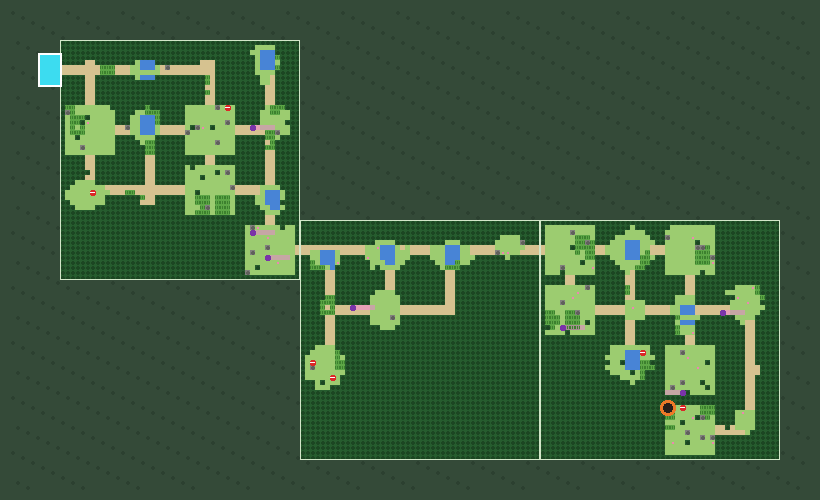
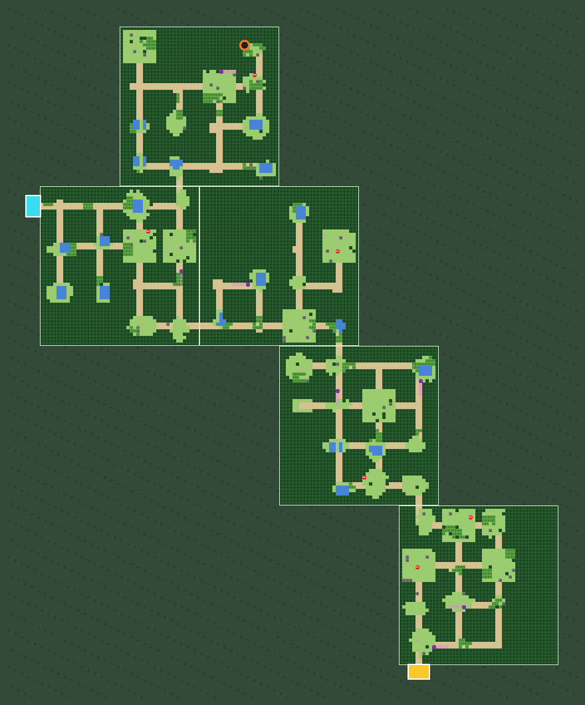

# Plan: Wild Routes, generated routes and dungeons off Kanto's maps

- **Status:** revised on 2026-10-11 with your answers (§1). WR1 and WR2 start now. The defaults I took for the small
  questions your answers left open are in §9; change any of them.
- **What it delivers first:** one **free-roam forest zone off Viridian City**.
  - A tree clearing in Viridian City leads, through the usual fade, into a **forest maze** in the empty overworld.
  - The maze is DWM-style areas joined edge to edge with no fade in between, each turned so its entrance meets the
    last area's exit. Inside are branches, dead ends, trainers, item balls and tall grass.
  - A dead end may hold a **dungeon**: PMD-style floors, made new on every visit, one copy per party.
  - You leave the way you came. The zone is made **once per world**, when the world is built.
- **Built to grow:** connecting routes between cities (your call, after this works), cave and ocean zones, and one
  day walking from Kanto into another game's world (§4.10).
- **Why:** your brief of 2026-10-10, your choices R1–R9 and your answers of 2026-10-11.
- **Sources:**
  - [ROUTES_RESEARCH.md](../research/ROUTES_RESEARCH.md) and its prototypes.
  - Gen1Recomp v0.3.49's own docs and source on GitHub: `README.md`, `docs/modding.md`, the registry reference,
    `WorldAPI.lua`, `Commands.lua`, `MapScripts.lua` and `OverworldController.lua` (read, nothing copied).
  - A read of today's code (Appendix A).
  - A prototype of the joined-up areas (Appendix B).
- **Size:** eight phases, WR1–WR8, with full test runs at four checkpoints. About 7–8 pod hours in all (under $4 at
  $0.48 an hour), plus checks on your PC.

---

## 0. How to execute this plan

- **CLAUDE.md's rules apply unchanged.** Nothing ROM-derived is opened, logged or committed. Pins don't change
  without your OK. Anything ambiguous, or a step that fails, stops the run with a question.
- **PLAN.md §0.2–0.5 apply as they do to the milestones:**
  - one commit per phase, titled `WR<n>: <title>`;
  - a "Wild Routes" section in PROGRESS.md;
  - new items in PLAYTEST.md.
- **Where things run:**
  - Code is edited on the server.
  - Java builds and tests run on the pod `kb-dev` through `kb-pod`.
  - Lua tests (`tools/lua`) and the Python tools run on the server.
- **The pod (your rule of 2026-10-11):** it's used whenever the work needs it, without asking, inside the budget you
  set in the RunPod app. It's stopped as soon as each job finishes, and never left running while waiting for you.
- **Tests (your rule of 2026-10-11):**
  - During a phase, only the tests for that feature run.
  - The full suite (`tools/check`, GameTests included) runs at four checkpoints: after WR2, WR4, WR6 and WR8.
- **Data rules for this feature:**
  - The route list holds only game and map ids (the engine's symbols, as everywhere in the repo), cell coordinates,
    counts and our own text. It never holds block ids, tiles, map contents or ROM text.
  - Every block the hidden game's maps gain is copied at boot from the player's own data. Logs print only ids,
    counts and hashes.
  - You choose where an exit goes, in your own game (§4.2).
  - Tests use the synthetic bundle (`tools/fake_gen1`) and synthetic route lists.
- **DESIGN.md is yours.** This plan adds exits to the ROM's maps because you asked for that (R1). DESIGN.md §3's line
  "joined edge to edge exactly as the original game connects them" still holds for Kanto's own maps. Whether to add
  a line about Wild Routes is up to you; I won't edit it.

## 1. Your choices and answers

| # | You chose | What the plan does |
|---|---|---|
| R1 | Extra routes, reached through new exits added to the game | A new exit in a ROM map leads to a small new map in the hidden game that stands for the route (§4.2) |
| Q1 | First a Viridian City free-roam zone; city-to-city routes later, your call. Walking into another game one day | Only the Viridian zone is built now. Every new format and the world's layout leave room for connecting routes and other games (§4.10) |
| R2 | They work as normal routes | Always open; nothing in Kanto is replaced or blocked |
| Q3 | Story checks: not relevant yet | None for the Viridian zone. They come back with connecting routes |
| R3, Q8 | Routes once, built with the world; dungeons every visit | The zone is built with the world, from its seed. Dungeon floors are made on each visit |
| R4, Q2 | Vanilla terrain with voxel props; the look depends on the kind of zone; a forest first | Forest: a tree clearing in Viridian City, then a forest maze. Caves and ocean are later themes |
| R5, Q4 | One long area per route, the areas turned and joined; 3–4 areas, a side area half the time | Areas chained edge to edge with their openings lined up and no fade. Branches and dead ends inside each area (§4.3) |
| R6, Q5 | Levels from the neighbouring maps; +1 per area, up to +3 | Species and levels come from the maps around Viridian City; each area adds a level, up to three |
| R7 | Rewards into the hidden bag and money | The hidden game gives the items and pays the prizes itself (§4.6) |
| R8, Q6 | 0–1 dungeon in a dead end; floors random, tied to the Pokémon's level, starting at 3–5; a treasure room | 3–5 floors for this zone, more for higher-level zones later (§4.8) |
| Q7 | Trainers can be fought again; NPC growth later | A trainer you beat challenges you again on your next visit. Each one counts how often you've beaten it, ready for growth later (§4.6) |
| R9 | One dungeon copy per party | Players who enter at the same entrance within 5 seconds share a copy |

## 2. How it plays

1. In Viridian City, a path runs into the trees. Walk to its end and the usual fade plays. You arrive at the
   **trailhead** of the zone, far from Kanto.
2. From there the forest runs on with no more fades: clearings, lanes between the trees, ponds, tall grass, and dead
   ends with item balls. Trainers spot you along their line of sight, walk up, speak and battle. Wild Pokémon appear
   in the grass as they do in Kanto.
3. A dead end may hold a cave entrance to a **dungeon**, new every time you go in: 3–5 floors linked by stairs, wild
   Pokémon in the rooms, items, sometimes a Monster House, and a treasure room at the end. Its exit brings you back
   out of the same entrance.
4. To leave, walk back down the trail at the trailhead. The fade plays and you're back in the clearing in Viridian
   City.
5. If you come back later, the forest is the same. Balls you've taken stay gone, for you only. Trainers want a
   rematch.

The figures come from the prototype (Appendix B):





In both games at once:

```text
Kanto (both games)           wild zone (Minecraft only)
VIRIDIAN_CITY  ── fade ──▶  trailhead ~~ areas, no fades ~~ dead end, dungeon
                              [A][x1]
hidden game:                KB_ROUTE_<ID>: the route map, two cells [A][x1]
```

## 3. What changed

**Since the research:**

- **No away hold.** Each zone gets a small map of its own in the hidden game, a *route map*. While you walk the zone,
  the hidden player stands in it. That's a real place in the game, so saving, loading, Fly and blacking out all work
  the game's own way. The research's border machine (VR A4.2) isn't needed.
- **The hidden game does more of the work:**
  - Item balls use the engine's `give_item`: the bag, the jingle and the "bag full" refusal.
  - Trainers use its scripted trainer battle. That's the path a story script's `start_battle` already takes through
    the bridge, so the prize money, the battle music, the trainer's loss line and the blackout all come for free.
  - Trainers' lines are its text boxes, mirrored as they are today.
  - That drops four pieces from the research's list: the `bag.add` act, the `money.add` act, a battle started by
    the server, and text boxes sent by the server.
- **Still new:** zone trainers and balls drawn by the server, lines of sight checked on the server, props drawn from
  their block state, zone habitats, and a blackout act for wild battles. The act also closes a gap in today's game,
  where losing a habitat battle in Kanto doesn't black you out.
- **Built with the world,** not on first approach.

**Since your answers:**

- **One zone first:** Viridian City's, a forest. No story checks yet.
- **The exit is a plain tree clearing.** It needs no door or cave tile: a step script on Viridian City's map takes you
  out when you reach the clearing's end (§4.2).
- **Trainers rematch** on each new visit, and keep a count for growth later.
- **Dungeon floors** are random, 3–5 here, with more in higher-level zones.
- **Room for later** (§4.10): connecting routes, other themes, other games.
- **The pod and the tests** follow your rules (§0).

## 4. Design

### 4.1 The route list

The list is one file, `gen1-bridge/data/routes.json`. gen1-bridge reads it at boot and passes it to the builder in
the world export, so both halves use the same list. Today it has one entry.

| Field | What it says | The Viridian zone |
|---|---|---|
| `id` | Our id | `viridian_forest_zone` |
| `name` | The name shown at the trailhead, in our own words | a name you like |
| `kind` | `free_roam` or `connecting` | `free_roam` |
| `from` | The exit: game, map, cell, facing and the clearing's depth | `red` or `blue`, `VIRIDIAN_CITY`, your spot |
| `to` | The far end, for a connecting route | none |
| `theme` | The look and the props | `forest` |
| `areas` | Areas on the main line, and the chance of a side area | 3–4, 0.5 |
| `levels` | Where species and levels come from, and the rise per area | `neighbours`, +1 per area, up to +3 |
| `trainers` | Per area, and when they want a rematch | 1–3, `each_visit` |
| `dungeon` | The chance of one, and its floors | 0.6, by level (§4.8) |
| `music` | The route map's song | a Gen 1 route theme |

Every map in the list is named with its game. The file holds nothing from a map's contents.

### 4.2 The hidden game: the exit and the route map

Gen1Recomp's content registries are built for this. Its `docs/modding.md` says: "An edited vanilla map becomes a
`mod.content.maps:patch` carrying only the fields that moved; a new map becomes a `:register`." gen1-bridge does both
in its entry chunk, before the engine merges everything:

- **The exit** is a patch of Viridian City's map.
  - A short run of blocks through the tree line becomes path. The path copies the block you were standing on when
    you chose the spot.
  - Before patching, a **signature check** uses the engine's own map queries. Every cell to be opened must be
    unwalkable now, and the clearing's mouth must touch the town's walkable ground. After patching, the whole path
    must be walkable.
  - If any check fails, the zone is switched off, and the log names the check and the zone's id.
- **The trigger:** a step script on Viridian City's map (map scripts compose with the engine's own; Gen1Recomp's
  `MapScripts.lua`). When you step onto the clearing's last cell, it warps you to the route map (`mod.world:warpTo`).
  On every other cell it does nothing, so the engine's own step scripts for the city still run. The bridge already
  follows scripted warps (`kb_warp.lua`, kind `script`).
- **The route map**, `KB_ROUTE_<ID>`, is two cells: `[A][x1]`.
  - You arrive on x1. A has a step script that warps you back to Viridian City, onto the clearing's second-to-last
    cell, facing the town, so you don't trigger the way out again.
  - It uses the overworld's tileset, so the engine treats it as outdoors and Fly works from it, as on any route.
  - Its floor block is picked at boot by asking the engine which of the tileset's blocks are plain floor, the way
    `engine.tileProbe` already probes tiles.
  - Nobody sees it: Minecraft doesn't draw it, and the hidden window is hidden.
  - A map is whole blocks, so it is really 2×2 cells. Its lower row is closed (WR4): gen1-bridge's
    `movement.collision` hook refuses a move onto it as a wall, and the zone has hedges there too, so the hidden
    player and you can never part on it.
  - A connecting route's route map later is `[A][x1][x2][B]`, with B leading into the far map.
- **Trainer classes:** at boot, `KB_<CLASS>` records are registered as copies of the Gen 1 classes the zone uses (the
  name, picture, prize money and AI). Each has one party, rewritten before every zone battle.
- **New acts.** PROTOCOL.md and the schemas change first.
  - `route.give {route, id, item}`: a queued script (`mod.world:queueScript`) runs the engine's `give_item`. The
    answer says whether the item went into the bag.
  - `route.battle {route, id, class, party, lines}`: writes the party, then a queued script shows the trainer's line
    and runs `start_battle trainer`. The bridge's existing script-battle path does the rest, including the prize.
  - `route.blackout`: the engine's own loss handling (`afterBattle("lose")`: heal, lose half the money, go back to
    the last Pokémon Center). It's for wild battles lost in Cobblemon, in zones and in Kanto.
  - `queueScript` refuses while another script is running, so these acts retry until the world is free.
- **Progress** lives in the hidden save's mod data, under `mod.save "routes"`, next to the bridge's other mod data:
  the balls you've taken and how often you've beaten each trainer.
  - It rolls back with the bag and money when an older save is loaded, as Kanto's own balls do.
  - The snapshot carries it to the server.
  - "Beaten on this visit" isn't saved: the server forgets it when you leave the zone.
- **The export** adds three things:
  - Viridian City's map with the clearing, built like any other map, so the clearing appears in Kanto;
  - the route map, flagged as a route map so the builder doesn't make it an interior;
  - the route list.
- **Your part:** stand where the clearing should start in Viridian City, face the trees, press F7 (it shows the
  hidden game's map, cell and facing), and send me what it says, with how deep the clearing should go.

### 4.3 Generating the zone

The prototype does all of this (Appendix B). WR1 writes it in Java.

- **Areas** are the research's DWM areas: 4×4 blocks of 12×12 cells each (96×96 Minecraft blocks), drawn with our
  own block designs for the forest theme.
  - Each area is made with its entrance on its own bottom edge.
  - Its exit goes on the top, left or right edge (odds 2:1:1), in the farthest block on that side.
- **Joining areas:**
  - The next area is turned so its entrance faces the exit, then slid along the shared edge until the two 2-cell
    openings meet. There's no fade and no gap: the edge works like a seam between two Kanto maps.
  - If the new area would overlap one already placed, it's made again. If that keeps failing, the area before it
    gets a different exit side.
- **Branches and dead ends:** DWM's layout gives T-junctions, crossings and dead ends inside each area. Half the
  time there's also a **side area**, a dead-end branch off the main line (Q4).
- **The ends:** the trailhead stands behind the first entrance. A free-roam zone's last area has no exit.
- **The dungeon (R8):** in a dead-end block in the far half of the zone, or at the end of the side area.
- **Items** follow DWM's counts by tier, scaled down to Gen 1 numbers. They go in dead ends first and never anywhere
  you can't reach. Gen 1 items only.
- **Trainers** stand on lanes with 3–4 cells of sight, apart from each other. They're never on the only way through,
  or between you and an item. 1–3 per area.
- **Levels and species (R6, Q5):**
  - They come from the habitat pools of the outdoor maps connected to Viridian City that have grass tables.
  - The first area matches them; each area after it adds one level, up to three.
  - Trainers get Gen 1 species from the same pools, chosen by class, at 0–3 levels above the area's highest wild
    level.
- **Seeds:** the world seed plus the zone's id. The same world gives the same zone every time (R3).
- **The prototype's numbers**, over 300 routes (3–4 areas on the main line, a side area in a third, a quarter of
  them free-roam):
  - 146–415 cells from end to end. The median is 266, about 70 s of walking without stops.
  - 2–18 dead ends (median 9) and 11–43 junction blocks.
  - 1–10 item balls (median 6) and 3–13 trainers (median 8).
  - Every route fits inside 576×576 blocks.
  - At most one retry, and 40 ms per route in Python.

### 4.4 Building it

- **The world's regions.** A small region table in the world folder names each region of the overworld and the game
  it belongs to: Kanto's box (where it is today), the wild zone, the dungeon zone, and room set aside for other
  games' worlds. The wild and dungeon zones are at least 3,000 blocks from Kanto's box and from each other.
- **Slots:** the wild zone is cut into slots of 640×640 blocks (40×40 chunks), one zone or route per slot.
- **Terrain (R4)** comes from Minecraft's own overworld noise for a seed, sampled without generating any chunks: the
  height of a column, from a `RandomState` (research §6.1). It costs about a millisecond a column, so it's sampled every
  16 blocks, blended smoothly, with a little small-scale relief of our own.
  - In v1, walkable cells are flat at Kanto's walking level (feet at Y 64), so today's spawn rule and lines of sight
    work unchanged.
  - Walls and the land around the maze keep the noise's hills.
- **The forest theme:**
  - The maze's walls are hedges of vanilla leaves, 3–5 blocks tall, with a trunk in some of them (D8). Lanes are grass
    and dirt path; tall grass and flowers in the clearings; ponds behind an invisible barrier, as Kanto's water is
    until Surf.
  - Around the maze, trees of vanilla blocks (oak, birch, dark oak), grass and ferns, so the maze sits inside a forest.
    Never on a lane.
  - A forest biome of our own sets the colours.
- **Rocks** are 2×2-block boulders of cobblestone and mossy cobblestone (D8).
- **Balls** are puppets (WR5): each player's own hidden game says whether a ball is still there.
- **Props:** signs and dungeon entrances become prop blocks that carry their kind in their block state, and the client
  draws each one by kind (research §6.2). The first comes with the dungeon entrance (WR7).
  - They use built-in models we make.
  - Texture packs can replace them through `prop:` keys.
- **The trailhead** is a small clearing, never turned. Its two mapped cells match the route map's `[A][x1]`. The
  zone's first opening meets it from whichever side the zone starts on.
- **Habitat blocks** sit under the tall grass and point at the zone's pools.
- **A build stage** runs after Kanto's. It generates the zone, places it and writes it.
  - The WorldIndex gains the zone's box and the route map's piece.
  - The build report gains counts and times per zone.
  - Measured (check C2, first half): planning a zone takes about 1.5 s, and a zone is about 2.7 million blocks, so
    placing it takes about a minute at today's speed. The other half of C2 (placing in a real world, the cost per tick)
    waits for a pod.

### 4.5 Moving through it

- **Into the zone:** the hidden warp into the route map is followed like any other warp. `WarpService` finds x1 in the
  route map's piece, at the trailhead.
- **In the zone:** inside the zone's box and off the route map's cells, while the hidden player is on that route map,
  `MovementSync` sends no steps or turns, the drift rule is off, and joining or reconnecting doesn't pull you back. The
  hidden player stands on x1.
- **The maze is closed:** every gate is ringed with hedges where it meets the land, and the cells under A and x1 are
  hedges, matching the route map's closed lower row. So you can stand on the route map only at A and x1, and only by
  walking in from the zone onto x1, where the hidden player is.
- **Out again:** walking back onto x1 needs nothing. Stepping onto A is an ordinary step; A's script warps you to
  Viridian City, and Minecraft follows.
- **Leaving any other way** (Fly, Teleport, a blackout) is a hidden warp, and Minecraft follows it as it does today.
- **Rules** are Kanto's: Adventure mode, no jumping, noon, Peaceful.

### 4.6 Trainers and items

- **Drawn by the server:** the server sends each player the zone's trainers and balls: their positions from the
  layout, their state from that player's progress. Your client draws them with the puppet renderer and your pack's
  sprites.
- **Sight** follows the Gen 1 rules, checked on the server: the same row or column, within the trainer's range,
  nothing in between, facing you. You're held still, the trainer walks up and shows "!", and then `route.battle`
  runs.
- **Rematches (Q7):** a trainer you've beaten leaves you alone for the rest of the visit. When you come back after
  leaving the zone, it challenges you again, with the same team. Each trainer counts how often you've beaten it, so
  NPC growth can build on that later.
- **Collision:** each trainer stands on a shared blocker. Balls use the per-player story cell, so a taken ball is gone
  for you only.
- **Balls:** clicking one sends `route.give`. If the item went into your bag, the ball disappears, for good.
- **Lines:** a list in the mod (our own text), chosen by trainer class.

**How WR5 builds it:**

- **One list for client and server:** the builder writes each zone's trainers and balls into its WorldIndex entry.
  Their cells are in the route map's grid (A is 0,0), so puppets, story cells and the server's sight checks use the
  index's own cell math.
  - A trainer: id, cell, facing, sight in cells, class, sprite, and party (species ids and levels).
  - A ball: id, cell, item. The zone also names the ball's sprite.
- **Where the values come from (§4.3):**
  - Parties: from the grass tables of the maps connected to the zone's town, 0–3 levels above the area's highest wild
    level; 1–2 Pokémon in the first area, 2–3 after it.
  - Sprites: from the export's map objects, the first object of the same class; the first item ball's sprite.
  - Items: a tier table in the mod, by area, keeping only items the game's own item list has.
- **Balls:** each ball's cell is a story cell of a new type, `route`. It's closed for you until your progress says you
  took the ball, so you bump into it as into Kanto's balls, and another player taking it changes nothing for you. A
  puppet draws it. Clicking it sends `route.give` straight to your hidden game; the `route.progress` that follows opens
  the cell and removes the puppet.
- **Trainers:** puppets drawn from the index, kept beside the hidden game's NPCs, each standing on a solid blocker
  built into its cell.
  - The server checks sight each tick for players in a zone: your cell against each trainer's facing and sight. Lanes
    are clear by construction. Trainers you've beaten on this visit are skipped.
  - On sight it sends `route.sight {route, id, x, y, frames}` (new): your client holds you still, shows "!" over the
    trainer and walks it to the cell in front of you. After those frames the server sends `route.battle` with the
    party and a line.
- **Relay:** your client forwards `route.give`, `route.battle` and `route.blackout` to the hidden game, and
  `route.result` and `route.progress` to the server.
- **Visits:** the server keeps the trainers you've beaten on this visit. The visit ends when your hidden player leaves
  the route map. The hidden save counts wins (WR2).

### 4.7 Wild Pokémon

- At build time, each area gets a pool made from the zone's neighbouring pools with its levels (R6, Q5), written next
  to Kanto's 46. `HabitatService` learns about zone habitats from the zone boxes in the WorldIndex.
- The zone's biome belongs to none of Cobblemon's spawn tags. Floors sit at Y 63, so today's spawn rule applies once
  it lists the zone's biome.
- Losing a wild battle sends `route.blackout`, in Kanto too.
- **As built (WR6):** a pool per area with tall grass (`kantobridge:zone_<zone>_a<n>`), habitat blocks covering that
  area's grass as in Kanto, and the server sends `route.blackout` after Cobblemon ends a natural wild battle with the
  player losing (not after a catch, not for the hidden game's own battles).

### 4.8 Dungeons

- **Going in:** stepping into the entrance starts a visit. Everyone who steps in within 5 seconds shares one copy
  (R9). You fade into a free slot of the dungeon zone.
- **How many floors (Q6):** random on each visit, tied to the dungeon's Pokémon. 3–5 floors where its wild Pokémon
  are under level 20, as in the Viridian zone. Both ends rise by one for every 10 levels above that, up to 7–9.
- **Floors** are PMD's standard floor (research §5), seeded from the visit: 112×64 blocks, cased in stone, lit
  according to the theme. The first floor is built behind the fade. Each next floor is built while you play the one
  before it.
- **Inside:**
  - Wild Pokémon stand at PMD's enemy spots, spawned with `EncounterService`, and more appear over time. They get a
    level stronger every second floor.
  - Some floors have a Monster House.
  - Items go into your bag through `route.give`.
  - Stairs fade you to the next floor.
- **The last floor** ends in a treasure room. Its exit brings you back out of the entrance.
- **The hidden game** stays in the route map the whole time. Fly is refused inside: the hidden game would allow it,
  because as far as it knows you're standing in the zone.
- **Limits:** dungeon item tables have no Rare Candy or Master Ball, and at most one valuable item (a Nugget) per
  visit. A slot is cleared when its last player leaves.

### 4.9 Multiplayer

- Zones are shared places. Trainers and balls are per player: puppets per client, progress in each player's hidden
  save.
- Dungeons are one copy per party, as above. A slot is reused once its party has left.
- Battles stay visible only to the player fighting, as today.

### 4.10 Room for later

Your answers named three things for later: connecting routes, other kinds of zone, and walking into another game.
None is built now, but each shapes something that is:

- **Connecting routes.** The route list already has `kind` and `to`, and the route map grows from `[A][x1]` to
  `[A][x1][x2][B]`. The story checks come back with them (Q3).
- **Other themes.** The generator and the builder take a theme: forest now; cave systems and ocean later. A theme
  sets the props, the scenery, the biome, the music and the exit's look. Caves can use a cave-mouth exit; ocean will
  need Surf rules.
- **Other games.** Gen1Recomp v0.3.49 runs nine games side by side: Red, Blue, Yellow, Gold, Silver, Crystal,
  FireRed, LeafGreen and Emerald (its README; Gen 2 is still under construction). Walking from Kanto into Hoenn or
  Johto would mean switching the hidden game to another game's save at the far end of a route. So the zones are
  built this way now:
  - **Map ids carry their game** in every new format: the route list, the route maps, the zone records in the
    WorldIndex and the region table. Today's formats stay as they are.
  - **The region table** sets aside room for other games' worlds, so nothing built now sits where they would go.
  - **A route's ends are typed.** A connecting route whose far end is in another game is a *cross-game route*. Its
    far end becomes a game switch, building on M9's runtime save switching. That switch is new work, for later.
  - **Each game patches its own maps** and registers its own route maps, so a cross-game route has a route map in
    each game.
  - **Progress sits behind one interface.** It's stored in the active game's save for now. A cross-game route may
    need a store outside the saves; that's decided when it's built. Items always go into the active game's bag.
  - **Species, levels, items and trainer classes come from the export of each end's game.** The Gen 1 limits (151
    species, Gen 1 moves and items) are settings per game, not constants in the generators.

## 5. Phases

The tags are PLAN's: **[L]** gen1-bridge, **[C]** client, **[S]** server, **[B]** builder, **[T]** tests,
**[D]** docs and protocol. Each phase runs its own feature tests; ✔ marks the checkpoints where the full suite runs.

### WR1: The generators

- [S] Areas (forest theme), joining, side areas, items, trainers, dungeon spots and levels; then PMD floors and the
  floor count by level.
  - Pure Java, with no Minecraft classes. A theme interface, with the forest as its first theme.
  - Our own table of block shapes and a modern random number generator. The port that matches DWM exactly stays in
    the prototype, as a reference.
- [T] JUnit:
  - golden layouts for fixed seeds;
  - checks over 10,000 seeds for each generator: openings meet, nothing overlaps, everything is reachable, and
    nothing blocks the way through.
- **Pod:** about 30 minutes, for the new tests only. **Needs you:** nothing.

### WR2: The exit and the route map ✔

- [D] The route list's schema, the new acts and the export's additions.
- [L]:
  - loading the route list;
  - at boot: the clearing with its signature check, the trigger, the route map and the trainer classes;
  - the acts `route.give`, `route.battle` and `route.blackout`;
  - progress in `mod.save`;
  - the export's additions.
- [T] Lua tests with the fake engine: the patch maths, the signature checks, registration, the triggers, the scripts
  and the acts. Export tests with the synthetic bundle.
- [T] End to end on the real engine, in the test instance:
  - walk into the clearing, arrive in the route map, and step back out;
  - receive an item;
  - win and lose against a generated trainer;
  - black out after a wild battle.
- **Checkpoint:** the full suite, after WR1 and WR2.
- **Pod:** about 30 minutes, for the checkpoint. **Needs you:** the exit's spot (§4.2), and an end-to-end session on
  your PC.

### WR3: Building the zone

- Check C2 first: stamp one zone into a void world and measure the time, the chunks and the cost per tick.
- [B] The zone stage: the region table, slots, terrain, forest props (server side), scenery, the trailhead and
  habitat blocks. Then the WorldIndex additions with their schema, and the report.
- [T] JUnit: regions, slots, pieces and index round trips. GameTest: a synthetic zone world, where openings are
  walkable, walls are solid and the trailhead is mapped.
- **Pod:** about 1.5 hours.

### WR4: Moving through the zone ✔

- [C] `MovementSync` inside zone boxes and at the trailhead. (Props moved to WR7, with the dungeon entrance: D8.)
- [S] `WarpService` into the route map's piece; the zone's rules.
- [T] JUnit for the movement cases; GameTests for the warps.
- Check C5 needs a client: your PC, or the pod under Xvfb.
- **Checkpoint:** the full suite.
- **Pod:** about 1 hour.

### WR5: Trainers and items

In three steps: the data (index, story cells, parties); the relay and balls; then trainers, sight and visits.

- [S] Zone trainers and balls sent to clients; sight; the walk-up; `route.battle` and `route.give`; rematches;
  progress from the snapshot.
- [C] Puppets from the server's feed; clicks on balls.
- [T] JUnit for the sight and rematch rules. GameTests with `fake_gen1`: a generated battle through the script path,
  an item received, and a full bag.
- **Pod:** about 1 hour. **Needs you:** an end-to-end session on your PC.

### WR6: Wild Pokémon ✔

- [B] Zone pools, written at build time.
- [S] Zone habitats, the zone's biome in the spawn rule, and the blackout act on lost wild battles.
- [T] Check C3 as a GameTest: a mix of pools, with levels in range. The blackout through `fake_gen1`.
- **Checkpoint:** the full suite. The zone is playable from here: walk it, fight, catch, pick up items.
- **Pod:** about 30 minutes.

### WR7: Dungeons

- [S][B] The dungeon zone and its slots; parties; the floor count; floors built behind the fade; stairs; spawns and
  Monster Houses; items; the treasure room; leaving; the limits.
- [T] JUnit for slots, parties and the floor count. GameTests: in, down two floors and out; two parties at once; a
  blackout inside.
- **Pod:** about 1.5 hours. **Needs you:** an end-to-end session.

### WR8: Content and play-test ✔

- With you: the zone's name, the trainers' lines and the item tables. The research's special areas (rest stop, item
  clearing, hedge maze, Mart stall, trainer gauntlet) if you want them.
- [T] PLAYTEST.md items, then a play-test on your PC.
- **Checkpoint:** the full suite.
- **Then:** you choose the first city-to-city routes.
- **Pod:** about 1 hour.

**In all:** about 7–8 pod hours (under $4). WR1 and WR2 run side by side; the rest go in order.

## 6. Checks

| # | What | Where | When | Cost |
|---|---|---|---|---|
| C2 | One zone stamped into a void world: noise sampling, features, one structure. Time, chunks, cost per tick | The pod, server only | Start of WR3 | About $0.50 |
| C3 | A generated battle through the script path; a mix of habitat pools | The pod, GameTests | WR5, WR6 | About $0.30 |
| C5 | Props drawn from their block state; fades at the trailhead | A client: your PC, or the pod under Xvfb | WR4 | About $0.50 |
| C6 | The route map, the clearing and its trigger on the real engine; `give_item` and `start_battle` from a queued script; a save and load inside the route map | Your PC, in the test instance | WR2 | Free |

The research's C1 becomes WR1. Its C4 becomes part of WR2's Lua tests, minus the away hold, which is no longer needed.

## 7. Risks

- **Nothing has been played in-game yet** (ROADMAP.md), and Wild Routes stacks on that unchecked base. A short
  play-test of plain Kanto before WR4 would help.
- **The engine:** the map changes, step scripts and gifts use Gen1Recomp's public mod API. Rewriting a trainer's party
  and the blackout reach into the engine's internals, as much of `kb_engine.lua` already does. Both are checked again
  on every pin change.
- **Saves inside a route map** need gen1-bridge loaded, as today's saves already need its mod data. A zone that a
  world uses is never removed from the list.
- **Changing the route list** after a world is built doesn't change that world in v1. A new zone needs a new world.
- **Effects that count steps** (poison damage outside battle, Repel, the daycare's EXP) don't tick in zones, because
  no steps reach the hidden game there.
- **Balance:** rematches pay prize money each visit, and balls pay once per player. Dungeon rewards are capped (§4.8).
- **Build time and disk:** about a minute of placing per zone at today's speed (measured), and an estimated 2–4 MB.
  A faster way to place a zone's blocks can come later.
- **Licences:** the generators are re-implemented from your notes, with our own tables. No DWM or PMD code, assets or
  names. Pools, sprites and trainer classes come from each player's own export and stay local.

## 8. Later, not in this plan

- City-to-city routes and their story checks.
- Cave and ocean zones; stepped terrain inside zones.
- Walking into another game's world (§4.10).
- NPC growth for rematches.
- Escape Rope and Dig inside dungeons (a cave route map for each dungeon).
- Adding zones to a world that already exists.

## 9. Defaults I took

Your answers left a few small things open. I went with these; change any.

| # | Question | Default |
|---|---|---|
| D1 | When does a beaten trainer want a rematch? | On your next visit, after you've left the zone |
| D2 | A rematch team | The same team. Growth comes later |
| D3 | How do you choose the clearing's spot? | Stand there, read F7, send me the map, cell and facing |
| D4 | The clearing's depth | 2 blocks (4 cells) into the trees |
| D5 | The dungeon's floors at higher levels | One more at each end per 10 levels above 20, up to 7–9 |
| D6 | The dungeon's Pokémon | A level stronger every second floor |
| D7 | Full test runs | After WR2, WR4, WR6 and WR8 |
| D8 | The forest's walls, trees and rocks | Vanilla leaves, logs and cobblestone: the Minecraft look, solid to walk into, no client work. Balls are puppets (WR5); voxel props stay for signs and the dungeon entrance, from WR7 |

## Appendix A: references

Prefixes: `M/` = `fabric-bridge/src/main/java/dev/kantobridge/`,
`C/` = `fabric-bridge/src/client/java/dev/kantobridge/client/`, `G/` = `gen1-bridge/`.
Gen1Recomp paths are in its repository at tag v0.3.49.

| Fact | Where |
|---|---|
| Nine games side by side; Gen 2 under construction | Gen1Recomp `README.md` ("What this is") |
| Maps edited by mods: a patch for an edited map, a register for a new one | Gen1Recomp `docs/modding.md` ("Editing maps in Tiled") |
| The `maps` record (blocks, warps, …), `map_scripts` (compose), `trainers` (name, parties, base money), `map_songs` | Gen1Recomp `docs/modding/reference/registries.md` |
| Patches merge tables and replace lists; `__append` adds to a list; registrations happen in the entry chunk, before the merge | Gen1Recomp wiki, "Concepts: Registries" |
| Step scripts: the first one that returns true wins; mods run before the engine's own | Gen1Recomp `src/script/MapScripts.lua:1-27` |
| Step scripts run after every completed step | Gen1Recomp `src/world/OverworldController.lua:4691-4698` |
| `queueScript`, `replaceBlock` (current map only), `warpTo`, `startWildBattle` | Gen1Recomp `src/world/WorldAPI.lua:626-632, 461-466, 358-370, 638-675` |
| `give_item`, `start_battle` | Gen1Recomp `src/script/Commands.lua:250-292, 339-393` |
| Blackout: heal, half the money, warp to the last heal point | Gen1Recomp `src/world/OverworldController.lua:5184-5225` |
| The bridge follows scripted and mod warps (kind `script`) | `G/observe/kb_warp.lua:1-34` |
| The bridge's script battles (`start_battle trainer` needs `data.trainers[class]`) | `G/lib/kb_engine.lua:1681-1772` |
| Prize = base money × the last Pokémon's level, paid when the result comes back | `G/lib/kb_engine.lua:1573-1584, 2085-2125` |
| Probing a tileset's tiles with the engine's own map | `G/lib/kb_engine.lua:5027-5047` |
| The bridge's mod data in the hidden save | `G/act/kb_party.lua:40, 71`; `G/act/kb_save.lua:41, 76` |
| The export reads pristine data, so it applies the zone's patches itself | `G/export/kb_export.lua:259-264` |
| Interiors found by a walk over warps (route maps must be left out) | `G/export/kb_export.lua:299-328` |
| F7 shows the hidden game's map, cell and facing | `docs/PLAYTEST.md:52` |
| Map kinds today: surface, interior | `M/world/MapPlacement.java:23-25` |
| Warps: a teleport to a map's cell through the WorldIndex | `M/server/WarpService.java:98-119` |
| Steps come from crossings in Minecraft; the drift rule | `C/move/MovementSync.java:401-428, 483-499` |
| Habitat pools: overworld only, keyed by the WorldIndex | `M/server/HabitatService.java:105-109, 354-363` |
| Spawning a wild Pokémon from code | `M/battle/EncounterService.java:157-233` |
| Puppets: client only, fed by gen1-bridge | `M/entity/PuppetEntity.java:11-20`; `C/puppet/PuppetManager.java:93-97` |
| Builder stages | `M/builder/BuildPhase.java`, `M/builder/BuildTask.java`, `M/builder/plan/WorldPlanner.java` |
| Everything else the research cited | [ROUTES_RESEARCH.md](../research/ROUTES_RESEARCH.md), Appendix A |

## Appendix B: the prototype

In `/home/claude/kb-routes-proto/` on the server, not in this repo. Python 3.12, standard library only.

- `chain.py`: whole zones and routes, as in §4.3. `python3 -I chain.py` makes 300 and prints the numbers above.
- `render_chain.py <dir> [dest:<seed>|roam:<seed> …]`: the figures. They are `roam:9` and `dest:7`.
- One fix on the way: an item could land on a cell cut off by the ragged edge of a clearing. Items now go only on
  cells you can reach. The research's `route.py` still has the old behaviour; its figures are unchanged.
- `dwm.py`, `route.py`, `pmd.py` and `render.py` are the research's prototypes, unchanged.
